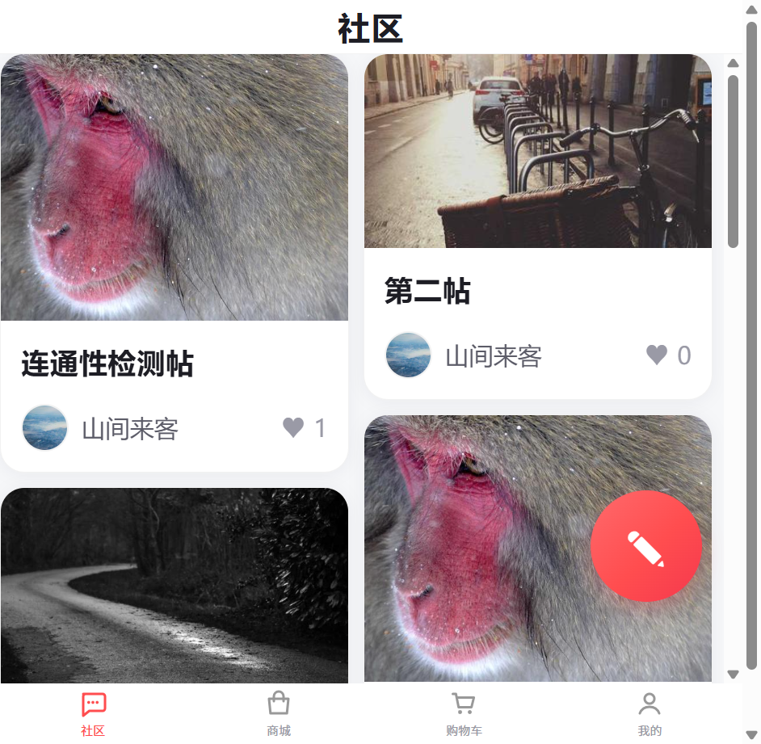
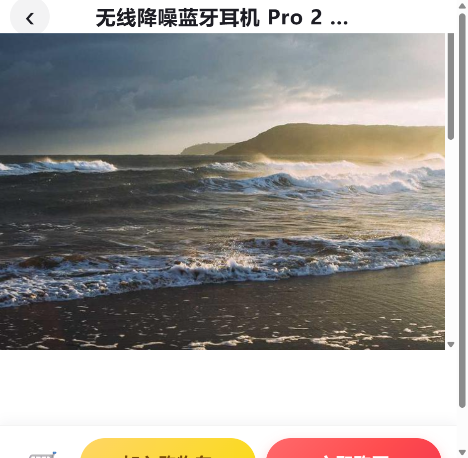
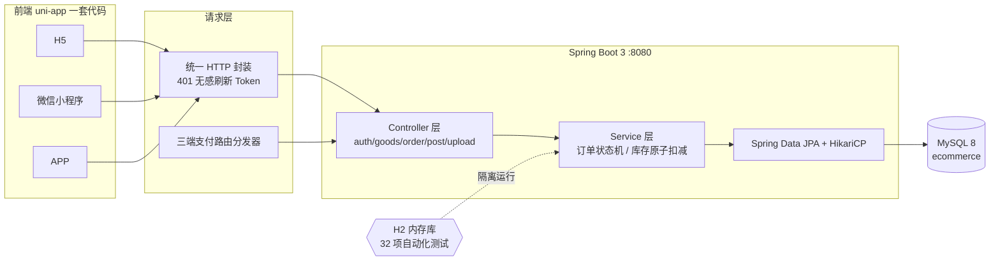
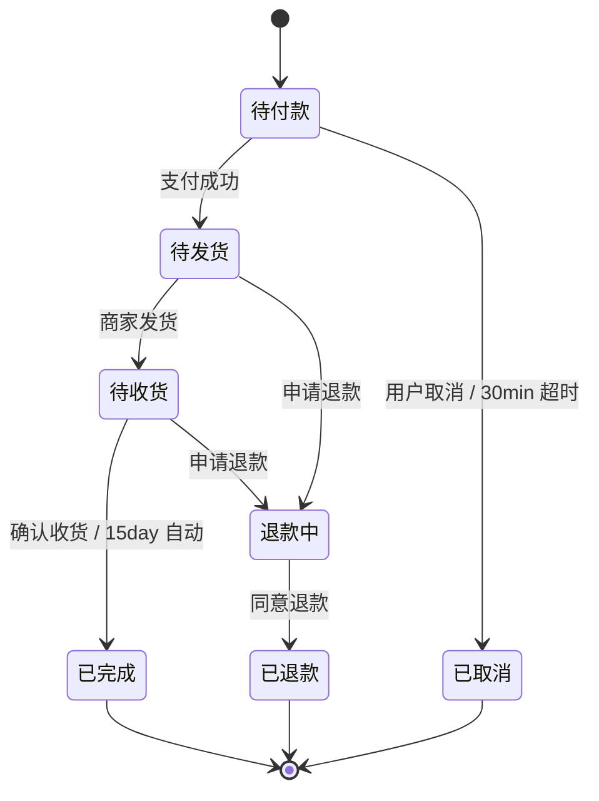

# 跨平台社区电商应用

> 一个「社区内容 + 电商交易」双驱动的跨端应用：前端基于 **uni-app（Vue3 + Vite）** 一套代码编译到 **H5 / 微信小程序 / APP**，后端基于 **Spring Boot 3 + MySQL**，覆盖内容发布、商品浏览、SKU 选购、购物车、下单支付、订单全生命周期状态机等完整业务闭环。


---

## ✨ 项目亮点

- **跨端一套代码**：uni-app 条件编译，H5 / 微信小程序 / APP 三端复用，按平台分别适配导航栏、状态栏与支付路由。
- **真实业务闭环**：内容瀑布流 → 商品详情 → SKU 选择 → 购物车 → 下单 → 支付 → 发货 → 收货 → 退款，订单严格按 **7 状态机** 流转，非法流转直接拦截。
- **并发安全防超卖**：库存扣减采用数据库级原子条件更新 `UPDATE ... WHERE stock >= n`，**10 线程并发抢购测试 0 超卖**。
- **工程规范完备**：统一设计令牌（颜色/圆角/间距/阴影）、请求层 **401 无感刷新 Token**、瀑布流虚拟列表 + 图片渐进式加载、**32 项自动化测试**（状态机 + Token + 全链路集成，H2 隔离可进 CI）。

---

## 🧱 技术栈

| 层 | 选型 |
| --- | --- |
| 前端框架 | uni-app 3.0 + Vue 3.4 + Pinia 2.1 |
| 构建 | Vite 5.2 + Sass |
| 后端框架 | Spring Boot 3.3.5（Web / Data JPA / Validation） |
| 语言 / 运行时 | Java 21 |
| 数据库 | MySQL 8（生产） / H2（测试隔离） |
| 连接池 | HikariCP（5–20，含泄漏检测） |
| 鉴权 | 自研 Access/Refresh 双 Token，支持无感刷新与一次性轮换 |

---

## 🖼️ 界面预览

| 社区首页（瀑布流 Feed） | 商城商品列表 |
| :---: | :---: |
|  |  |
| **商品详情（价格/SKU）** | **我的（订单入口）** |
|  |  |

---

## 📦 功能矩阵

| 模块 | 关键能力 |
| --- | --- |
| 社区 | 瀑布流虚拟列表、图片渐进式加载、快速滑动暂停非可视区请求、点赞、发布（9 图上限 / 本地压缩 / ≤3 并发上传 / 1000ms 防抖存草稿 / 3s 发布防刷） |
| 商品 | 多规格 SKU 联动置灰、动态价格库存实时更新、数量步进器库存边界禁用 |
| 购物车 | 实时价格计算、店铺级联选、失效商品分组、库存边界校验、结算前二次拦截 |
| 订单 | 7 状态流转、超时未支付自动取消、发货后自动确认、原子扣减防超卖、退款申请/同意 |
| 用户 | 验证码登录/注册、双 Token 无感刷新、订单状态徽标 |
| 跨端 | 三端导航栏/状态栏适配、统一支付路由分发器、iOS 底部安全区 |

---

## 🏗️ 系统架构



**订单状态机（7 状态）**



---

## 🚀 快速开始

### 环境要求
- Node.js ≥ 18，Java 21，Maven ≥ 3.9，MySQL 8

### 1. 启动后端

```bash
# 建库（首次）
mysql -uroot -p -e "CREATE DATABASE IF NOT EXISTS ecommerce DEFAULT CHARSET utf8mb4;"

# 配置连接（按需修改环境变量，默认 localhost:3306/ecommerce）
export MYSQL_USER=ecom_app
export MYSQL_PASSWORD='Ecom#2026'

# 运行（表结构与种子数据由 JPA ddl-auto:update + DataInitializer 幂等初始化）
cd backend
mvn spring-boot:run        # 或：mvn package && java -jar target/ecommerce-backend-1.0.0.jar
```

后端监听 `http://localhost:8080`，接口前缀 `/api`。

### 2. 启动前端（H5）

```bash
npm install
npm run dev:h5             # 开发：http://localhost:5173（Vite 代理 /api → :8080）
npm run build:h5           # 产物：dist/build/h5
npm run dev:mp-weixin      # 微信小程序（微信开发者工具导入 dist/dev/mp-weixin）
```

### 3. 登录体验

演示账号：手机号 `13800008888`，验证码 `8888`。

---

## 🔌 API 概览

| 方法 | 路径 | 说明 | 鉴权 |
| --- | --- | --- | --- |
| POST | `/api/auth/login` | 验证码登录，签发双 Token | 否 |
| POST | `/api/auth/register` | 注册 | 否 |
| POST | `/api/auth/refresh` | 刷新 Access Token（一次性轮换） | 否 |
| GET | `/api/goods/list` | 商品列表（关键字/分页） | 否 |
| GET | `/api/goods/detail` | 商品详情 + SKU | 否 |
| GET | `/api/shop/list` | 店铺列表 | 否 |
| POST | `/api/order/create` | 下单（原子扣减库存） | 是 |
| GET | `/api/order/list` | 我的订单（按状态） | 是 |
| POST | `/api/order/pay` | 支付 | 是 |
| POST | `/api/order/cancel` | 取消（回补库存） | 是 |
| POST | `/api/order/ship` | 发货 | 是 |
| POST | `/api/order/confirm` | 确认收货 | 是 |
| POST | `/api/order/refund/apply` | 申请退款 | 是 |
| POST | `/api/order/refund/agree` | 同意退款（回补库存） | 是 |
| POST | `/api/stock/check` | 结算前库存二次校验 | 是 |
| GET | `/api/post/list` | 社区 Feed 分页 | 否 |
| POST | `/api/post/publish` | 发布内容 | 是 |
| POST | `/api/post/like` | 点赞/取消 | 是 |
| POST | `/api/upload/image` | 图片上传 | 是 |

---

## 🧪 测试

```bash
cd backend
mvn test -Dtest=OrderStateMachineTest,TokenServiceTest,EcommerceApiIT
```

| 测试类 | 数量 | 覆盖 |
| --- | --- | --- |
| `OrderStateMachineTest` | 18 | 全部合法流转 + 非法流转拦截 |
| `TokenServiceTest` | 5 | 签发 / 校验 / 过期拒绝 / 一次性轮换 |
| `EcommerceApiIT` | 9 | MockMvc 走真实 Controller→Service→JPA→H2：公开接口、错误验证码、无/伪造 Token 拦截、订单全生命周期、库存二次拦截、超卖拦截、**10 并发抢购 0 超卖**、Token 复用拦截 |

集成测试使用 H2 内存库，与主工程 MySQL 完全隔离，可直接接入 CI。

---

## 🐳 部署（Docker Compose）

一键拉起 MySQL + 后端 + 前端（Nginx 托管 H5 并反代 `/api`）：

```bash
docker compose up -d --build
# 前端 http://localhost:80 , 后端 http://localhost:8080
```

相关文件：`docker/backend/Dockerfile`、`docker/frontend/Dockerfile`、`docker/frontend/nginx.conf`、`docker-compose.yml`。

---

## 📁 目录结构

```
.
├── src/                    # uni-app 前端
│   ├── pages/              # 12 个页面
│   ├── components/         # 导航栏/瀑布流/懒加载图/SKU 面板/结算栏
│   ├── api/                # 统一请求层（含 401 无感刷新）
│   ├── store/              # Pinia：user / cart / order / post
│   └── uni.scss            # 全局设计令牌
├── backend/                # Spring Boot 后端
│   ├── src/main/java/.../controller   # auth/goods/order/post/upload
│   ├── src/main/java/.../service      # 状态机 / Token / 库存
│   ├── src/main/java/.../repository   # JPA + 原子扣减
│   └── src/test/java/...              # 32 项自动化测试
├── docker/                 # 容器化部署
├── docs/screenshots/       # 界面预览
└── docker-compose.yml
```

---

## 📝 设计说明

- **防超卖**：下单扣减走 `UPDATE sku SET stock = stock - n WHERE id = ? AND stock >= n`，返回 0 即库存不足，由数据库行锁保证「检查+扣减」原子性；取消/退款回补同样原子化。
- **无感刷新**：请求层捕获 401，用 Refresh Token 换取新 Access Token 并重放原请求；Refresh Token 一次性轮换，旧值复用直接拒绝。
- **跨端支付**：前端封装统一支付路由分发器，按运行平台（微信/支付宝/H5/APP）调用对应渠道，业务层无感知。
- **性能**：瀑布流采用虚拟列表仅渲染可视区，图片懒加载 + 渐进式占位，快速滑动时暂停非可视区图片请求。

---

*本项目为跨端全栈练手工程，业务数据由后端种子数据初始化器提供，登录验证码在演示环境固定为 `8888`。*
